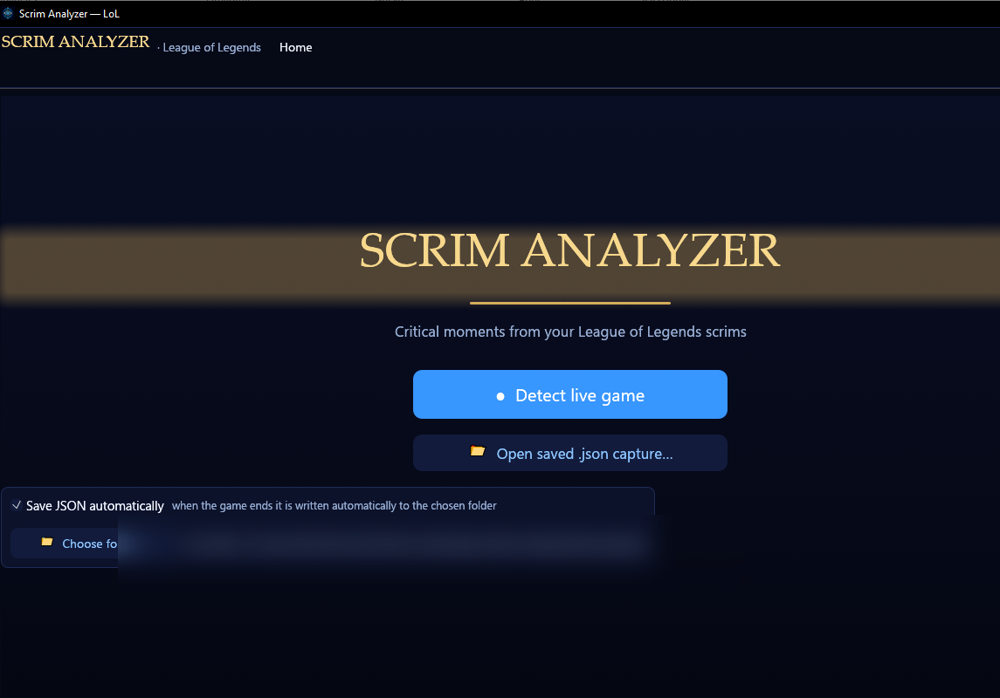
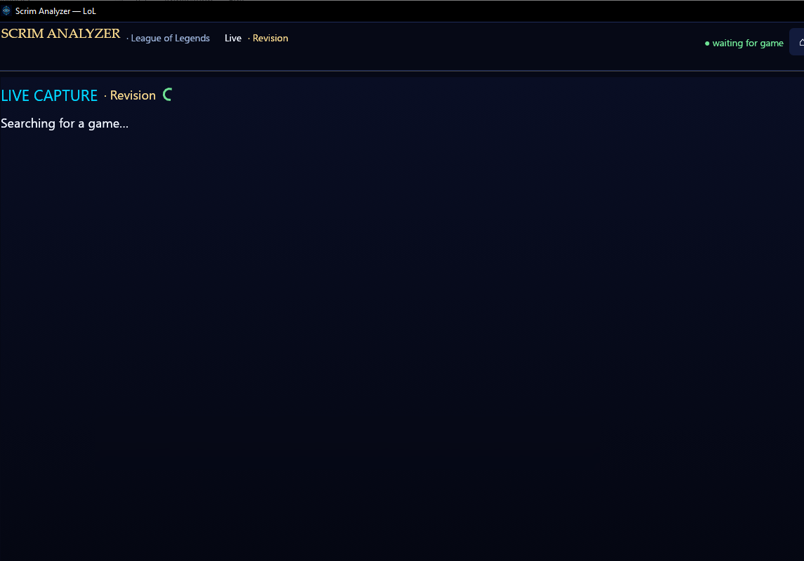
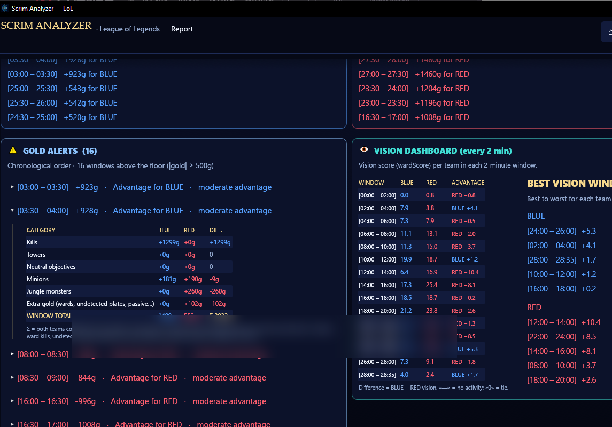

# Scrim Analyzer

**A free, local desktop app for reviewing League of Legends scrims**, written in Rust. It turns a replay into a post-game report: gold advantage in 30-second windows, vision every 2 minutes, objective markers, per-window alerts and the best/worst windows for each team.

No overlay, no injection, no telemetry. Everything is computed on your machine, and the UI is available in English (default), Spanish, French, German and Korean.

[**Download for Windows**](https://github.com/muliz2243-prog/scrim-analyzer/releases/latest) · [Portable ZIP](https://github.com/muliz2243-prog/scrim-analyzer/releases/latest) · [Visual guide](docs/VISUAL_GUIDE.md)

> Windows 10/11. League of Legends must be installed and the client open to fetch the official match timeline.

## Quick start

1. Download and run the installer (or unzip the portable build).
2. Open League of Legends.
3. Press **Detect live game** and give the review a name.
4. Open the replay, set **8x** and wait for the report to appear.



## What it shows

- **Gold timeline** — net gold for each 30-second window, with severity alerts (minor, medium, considerable, critical). Each alert bar is split in two: the left half is the severity and the right half is the team that held the advantage (blue or dark red).
- **Best windows per team** — the five windows that decided the scrim for each side, plus every 30-second window with a category breakdown (kills, towers, minions, jungle, extra gold).
- **Vision dashboard** — vision score every 2 minutes and the best vision windows for each team, measured from the live client while the replay plays.
- **Objective timeline** — dragons, heralds, void grubs, barons and inhibitors placed on the match timeline.
- **Notes and JSON export** — annotate the review and save the full capture for later analysis.

| Live capture | Gold and vision |
|---|---|
|  |  |

## How it works

Scrim Analyzer combines three local sources:

1. **LCU timeline** — the official per-match timeline exposed by the League client on `127.0.0.1`. It provides real net gold per frame, objectives and match metadata.
2. **Live Client Data** — while a game or replay is running, the app polls the local live endpoint once per second to record `wardScore`/wards and build the per-window vision series.
3. **`.rofl` container** — when the timeline is unavailable, the app falls back to a forensic analysis of the replay file (metadata, players, legacy telemetry).

It links a replay to its match through the `gameId` in the `.rofl` filename and the client's `r3dlog`, so the report is built from the official timeline in seconds instead of parsing a 19 MB container.

## Replay format support

It supports **both container variants**, detected automatically:

| | Legacy (historical) | Modern (patch 16.x onwards) |
|---|---|---|
| Compression | zlib | **Zstandard** (segments) |
| Metadata | header JSON | **footer JSON** with `statsJson` |
| Duration | footer | footer (`gameLength` in ms) |
| Players | header JSON | `statsJson` (10 objects) |
| Frames (x, y) | ✅ decoded | ⏳ experimental, unverified (see below) |

It extracts from the `RIOT` binary:

- **Header / metadata**: `RIOT` magic, gameId, patch version, duration.
- **Players and teams**: champion, side (Blue vs. Red), win/loss,
  KDA, gold, CS (lane + jungle), damage and wards. In the modern format **there
  are no summoner names in the file** (omitted for privacy) and
  the champion comes as a name through the `SKIN` key (e.g. `Gwen`).
- **Frame-by-frame telemetry** (legacy format): coordinates (x, y), health, mana
  and level of the 10 champions per tick (with configurable sampling).
- **Vision events** (legacy format): wards placed/destroyed with type,
  coordinates (x, y) and timestamp in ms.
- **Section summary** (modern format): histogram of section types in the
  payload with times and sizes (`Replay.sections`), the basis on which to
  continue the reverse engineering of frames and wards.
- **Per-team totals**: aggregated gold, CS, kills, assists, wards and damage.

## Modern format (reverse-engineering summary)

```text
[RIOT][u16 ver=2][u64 gameId][.NET string gameVersion]
[segment]*   each one: [u32 keyframe][u32 chunk][u8 type][u32 uncomp][u32 comp] + data
              comp = 0 ⇒ data stored uncompressed; comp > 0 ⇒ Zstandard frame
[footer JSON] {"gameLength":ms,"lastGameChunkId":…,"statsJson":"[ …10 players… ]"} + signature
```

Inside each segment, the data is a stream of sections
`[u8 H][time][len][type u16][params][data]` (with type inheritance and short
lengths according to the bits of `H`). The parser validates that the sections
fill each segment exactly and that the final time matches the
footer duration. In a real 9.7 MB replay: 71 segments and 1,157,983
sections parsed without errors.

## Status of the modern format reverse engineering

1,157,983 sections have been parsed empirically from a real replay
(16.20.824.8524, 1352.3 s) and several hypotheses have been tested. Result:

| Section | Hypothesis tested | Result |
|---|---|---|
| **61** (positions, ~23 Hz) | Mask in `tail[3]`: `0x0B`(3), `0x80`(1), `0xC8`(3), `0xE8`(4 fields) | **Solved (experimental)**: layout with mask E8, fields at bits 13 and 30 of the `tail[4..]` block (14 bits each, wrap +8192). Passes the physical gate (team separation 3748 u, 6+5 champions at fountains, high variance, 100 % continuity). Emits `positions` (10 champions, ~876–1191 samples). |
| **61** | CS/kills/assists as integer fields in the champion record | **Negative** (direct search against the final totals of `statsJson`). |
| **723** (380,778 × 2 B, ~282 Hz) | `(dx,dy)` i8 or absolute `u16` per entity | **Discarded**: it only alternates two values (`45 9A`/`43 …`) ⇒ a flags/tick stream. |
| **All types** (cross-scan) | Gold in any section | **Definitive negative**: scan of 251 section types, aligned and unaligned u32/u16/f32, exact ±5 and range [4000,13000]. Only type 769 has 21% in range (no exact hits). **Gold is not in the replay as a readable numeric field** — only the final totals in `statsJson`. |
| **1140** (entity stats) | Same grammar as 61 | Open: it contains champion anchors, variable structure (bitmask). |
| **166 / 131 / 1183 / 850** (events) | Game event streams | **Solved and verified**: kills (51), assists (53), plates (58) and turrets (6) with exact timestamps. |
| **Wards (all paths)** | Ward events (placement + destruction) with `(t, x, y, owner)` in the modern format | **Definitive negative** (RE campaign v84–v90): no section with count 74/9, they are not entities of stream 61 (only 10 champions + 6 structures, verified over 30,995 records and 23 keyframes), nor do they carry their own coordinates (f32/14-bit sweep: the only f32s are `44 44 44 44` padding). `statsJson` provides **only totals** (74/9, per player). In modern `.rofl` spatial vision is left **documented as omitted**. |

## Economic events (solved and verified)

The modern-format stream **does** carry game events with their exact
timestamp. Each event type is detected by `(section type,
length)`:

| Type | Event | Records | Length | Validation |
|---|---|---|---|---|
| **166** | Champion kill | 51 | fixed 5 B | `CHAMPIONS_KILLED` = 51 |
| **131** | Assist | 53 | fixed 3 B | `ASSISTS` = 53 |
| **1183** | Turret plate | 58 | 1–2 B | `Missions_TurretPlatesDestroyed` = 58 |
| **850** | Turret destroyed | 6 | fixed 5 B | `TURRETS_KILLED` = 6 |

Additional corroboration:

- Types **166 / 421 / 563 / 1166** are **four redundant views** of the
  same stream of 51 kills: their timestamps are **bit-for-bit identical**
  (max|Δt| = 0.0000 s).
- Spacing is **irregular** (CV = 1.30), not periodic ⇒ they are real
  events, not snapshots.
- The last kill falls at **t = 1337.441 s**, and `statsJson` publishes
  max `LAST_TAKEDOWN_TIME` = **1337 s** (rounded to seconds). It matches.
- Types **232** and **850** share the same 6 timestamps; 850 is used because
  it has a fixed length.

**Verification is dual**: the four counts must match the `statsJson`
*exactly* **and** the last kill must fall at
`LAST_TAKEDOWN_TIME`. If anything does not add up, no event is emitted
(`events_report.fuente = "no_disponible"`), so as not to export false events.

## Why per-team gold still cannot be reconstructed

The detected events carry a timestamp, but **not** the attribution to
player/team, and without it splitting gold by team would be **fabricating data**.
These attribution paths were tried and discarded:

1. **Entity identifiers in the event records**: per-value histograms
   that do not reproduce kills/assists per player (e.g. the field
   `bytes[4..6]` of type 421 gives `[1,1,1,1,1,3,5,6,11,21]` versus
   the real `[0,1,2,3,3,4,6,6,11,15]`).
2. **Leftover fields of the E8 mask** (bits 47 and 64): **they are not health**; they have
   the full 14-bit range and drop to ~0 on **seven champions at once**
   during a single kill ⇒ kinematic noise.
3. **Position gaps as death**: 558 noise gaps for 10 champions,
   so that 50/51 kills "match" by chance.
4. **Temporal correlation with `LAST_TAKEDOWN_TIME`**: consistent but not
   demonstrative (no unique bijection was found).

It was also confirmed that `statsJson` **contains no time series**: its
313 keys per player are all scalar (0 arrays, 0 objects), and the decompressed
payload (26.5 MB) **contains not a single readable ASCII string**
(0 occurrences of "gold", "item", "shop", "timeline", …).

**Consequence**: `gold_blocks.fuente` remains `"no_disponible"`. Once
the attribution is decoded, it is enough to distribute each event by team and
call `compute_gold_blocks(&serie, duration_s, "reconstruido_por_eventos")`.

**Consequence in the code**: `Replay.positions` is emitted **empty** unless the
decoding passes the physical validation gate (`plausible_positions`:
team separation ≥ 4000 u, clustering next to a fountain at t < 90 s,
high variance, 100 % velocity continuity and rejection of constant
series). In the reference replay the gate **is** passed and 10 champions
are exported with ~876–1191 samples each. If a replay does not pass it, the
positions are discarded with an explicit warning and unverified data is never
exported.

**Temporal gold (30 s blocks)**: the gold-per-tick stream **still has not
been decoded**, and the economic events discovered **carry no team
attribution** (see below). The block engine (`blocks::compute_gold_blocks`)
is implemented and covered by unit tests, and the JSON always exports the
full structure (`GoldBlocksReport` with `fuente`, `block_secs`, `blocks`,
`top5_azul`, `top5_rojo`) with `fuente = "no_disponible"` when there is no real
series (the deltas are zero and the Top 5 lists are empty). Thus the future GUI
can consume a stable shape without invented data.

## Wards in the modern format (definitive negative, RE v84–v90)

The coach's requirement was the ward map: **distributing over time the
spatial distribution of wards alive at minute X + the face of the champion that
placed it, along with their destructions**. In the modern format this **cannot be
extracted**, and it is documented as an omission (it is never filled with zeros nor
is a position invented):

| Path tested | What was looked for | Result |
|---|---|---|
| Section with count = 74 (placements) or 9 (kills) | Census of the ~150 types in the stream | **None exists**: no type with n=74 (nor 73/75). The n=9 ones (722, 984, 151) are other events: 722/866 are **exact 60 s periodic** (buffs), 984 clusters at the start, 151 are kill side-events. |
| Wards as **entities** in the position stream (type 61) | New entities with their own ID, stationary position, ~90–180 s lifetime | **They are not entities**: the whole stream (30,995 records) contains only **16 IDs** = 10 champions + 6 structures (turrets/nexus, already present at t=0). |
| Wards in the **keyframes** (23 full snapshots, every 60 s) | Additional live entities mid-game | **No**: each keyframe lists 11–19 entities (champions + structures). |
| **Coordinate sweep** (definitive test) | Any `(x,y)` in map range with f32 encoding (like legacy) or 14-bit | **No wards**: the "plausible" f32s are **padding** (`44 44 44 44` = 785.0), not positions. |
| `statsJson` | Ward totals | **Only scalar totals**: 74 placed / 9 destroyed, per player and team (`WARD_PLACED`, `WARD_KILLED`). No coordinates or timestamps. |

**Consequence**: in modern `.rofl` **spatial vision is left documented as
omitted**. The vision axis (V) uses the *per-player totals*
from `statsJson` (measured), not the spatial distribution. The `legacy` fallback
(`payload.rs`) **does** extract `WardPlaced{x,y}` and `WardKill{x,y}` with
coordinates, but without an owner.

## Ward sources by data origin

| Source | Wards with `(t, x, y)` | Owner | Destructions | Status |
|---|---|---|---|---|
| **Modern** `.rofl` (16.x) | ❌ | ❌ | ❌ (total only) | **Documented omission** |
| **Legacy** `.rofl` | ✅ (`WardPlaced`/`WardKill`) | ❌ | ✅ | Works (verified: 21/21 in `test.rofl`) |
| **Live Client API** (scrims) | ❌ (`minimap` → 404) | ❌ | ❌ | `scores.wardScore` and, as a fallback, `wardsPlaced`/`wardsKilled` per champion from `/liveclientdata/stats` (measured count) |

**For the coach**: *spatial vision with champion faces* only exists in legacy
replays. In live scrims and modern replays one must settle for the
**vision activity aggregated per player** (`wardScore` / totals), which do
feed the vision axis (V) without fabricating anything.

## Structure

```
src/
  lib.rs      Public API (analyze_file / analyze_bytes / to_json)
  main.rs     CLI (.rofl analysis + live --scrim mode + --recalc)
  gui_main.rs Local graphical interface (`scrim-analyzer` binary, `gui` feature)
  gui/        Interface modules: one file per screen or panel
    theme.rs    Palette, typography, preferences and app visuals
    state.rs    Shared types: messages, views and annotations
    capture.rs  Background threads (live poller, replay, vision, LCU)
    data.rs     Save/load captures and rebuild the report
    charts.rs   Accumulated gold/vision charts and time bar
    home.rs     Home screen
    live.rs     Live dashboard
    vision.rs   Vision dashboard and gold breakdown table
    report.rs   Report screen
    replay.rs   Replay screen
  header.rs   Legacy header: RIOT magic, offsets, footer
  metadata.rs Deserialization of the metadata JSON (serde)
  chunks.rs   Chunk table + zlib decompression (flate2)
  modern.rs   Modern container: zstd segments, statsJson footer, sections
  events_extract.rs Economic events of the modern format, verified against statsJson
  payload.rs  Legacy payload walk: frames (type 3) and events (type 4)
  live.rs     Live collector (Live Client Data API) → 30 s blocks
  tls.rs      Native HTTPS client with the client certificate PINNED
  score.rs    Legacy name: 30 s gold blocks, breakpoints and vision module
  blocks.rs   Fixed 30 s blocks with per-team gold delta and Top 5
  cursor.rs   Zero-copy little-endian binary reader, no unsafe
  model.rs    Lightweight serde structs (Replay, FrameSnapshot, Event...)
  format.rs   Format constants (all offsets live here)
  error.rs    Idiomatic errors (thiserror)
tests/
  synthetic.rs       Legacy end-to-end test with an in-memory synthetic .rofl
  modern_synthetic.rs End-to-end test of the in-memory modern container
  tls_local.rs       Native HTTPS client against a self-signed TLS server
installer/
  installer.iss      Installer (Inno Setup 6), no README inside
examples/
  probe.rs       Forensic probe (section histogram / key extraction)
  event_fields.rs Byte histogram of events vs. ground truth (attribution)
  death_probe.ps1 Cross-check of position gaps/stillness vs. real kills (negative)
  ventanas_alerta.ps1 Kill/turret breakdown per window with alert
  make_test_rofl.rs  Generator of a synthetic legacy .rofl on disk
  captura_demo_sintetica.json  --recalc demo with the 5 axes + vision (NOT real data)
```

## Real gold, severities and vision module (`src/score.rs`)

The metric is **real gold, not points**. The GUI captures the official match
timeline from the local League client and reads each team's net gold from
`participantFrames[].totalGold`; the report aggregates it into **30 s
windows** (`[0,30)`, `[30,60)`, …). If the timeline is available, the numbers
are the game's own gold: nothing is estimated.

Only when the LCU timeline is unavailable (an old capture, or a `.rofl`
whose `gameId` returns 404) does the app fall back to a points model,
exported and calibratable (`ScoreParams`):

| Action | Gold equivalence (fallback) |
|---|---|
| 1 kill | 300 g |
| 1 turret | 250 g |
| 1 plate | 175 g |
| dragon | 500 g |
| herald | 300 g |
| baron | 1500 g |
| 1 CS | 20 g |

On the LCU path, **measured gold rules**: the per-axis breakdown
(`gold_breakdown.rs`) estimates kills, turrets/plates and objectives from the
events and assigns the rest (minions, jungle, passive gold) to `cs`. The sum of the
axes is **always exactly** the block's gold delta; if the estimates
exceed the measured gold they are scaled, gold is never invented.

Axes without real data — no turret/objective events in the whole scrim, or
no CS activity measured in any window — are marked `available: false`
(contribution 0, **documented**, never an invented zero that dilutes the gold advantage).

### Severity of each window (where the game broke)

**Permanent cuts on the net gold of the 30 s window**, exported and
calibratable (`SeverityThresholds`):

| Interval | Level | Real anchor |
|---|---|---|
| [500 g, 800 g) | `slight advantage` | a plate + some farm |
| [800 g, 1200 g) | `moderate advantage` | ~3 kills or a turret + farm |
| [1200 g, 1500 g) | `strong advantage` | a turret + kills |
| ≥ 1500 g | `critical advantage` | a baron or an objective fight |

An isolated kill (~300 g) stays **below the floor**: it is noise, not a moment.

The gold advantage is **permanent**: the same advantage is worth the same at
minute 4 as at 25, so two games compare directly.

**Epic monster buffs do NOT add to the gold advantage** (they are temporary
and would dirty the curve): they are reported separately in `dominion.avisos`
(«BLUE took the baron at 03:20, buff until 06:50») so that the analyst can
match them with the later gold rises.

Windows above the floor are listed in `dominion.breakpoints`, **each
block separately and without merging**: two consecutive alerted windows are two
independent decisions (two mistakes in a row ≠ a snowball) and both
notices are kept. Each alert carries **the outcome** (the window's net gold, with its sign)
and the level. The **Top 5 successes and disasters per team never uses a
threshold**: it always comes out complete.

### Epic objectives (dragon / herald / baron) and their limit

**Measured in the live API (2026-10-20)**: the Live Client Data API **does not
expose dragons, heralds or barons through any channel**:

| Path | Epic objectives? |
|---|---|
| `events.Events` (feed) | ❌ only `ChampionKill`, `TurretKilled`, `InhibKilled`, `Multikill`, `Ace`… |
| `scoreboard` | ❌ the key **does not exist** in the response |
| `allPlayers[].scores` | ❌ only `kills/deaths/assists/creepScore/wardScore` |
| `/liveclientdata/playerstats` | ❌ 404 in game |
| LCU (`/lol-gameflow/...`) | ❌ |

That is why the report **does not mention them**: there is no measured data to show
and nothing is invented. The report keeps to what is actually measured live,
with team and minute: **kills, turrets, plates, inhibitors and CS**.


### Vision module (independent of gold)

Vision is measured in **1-minute windows** (2 blocks of 30 s): in 30 s a
team places 1–2 wards and the distribution is noise. The **shrunk share**
`(Δblue + p) / (Δblue + Δred + 2p)` is computed with `p = 1.2` wards expected per team
(without that shrinkage, 2 wards against 0 gave 100 %/0 % and tripped «critical» over
a sampling artifact) and a minimum activity of **4 wards** in the
window is required: below that, nothing is asserted.

The cuts are the same four levels as gold: `|deviation|` ≥ 0.08 →
slight advantage, ≥ 0.12 → moderate, ≥ 0.16 → strong, ≥ 0.20 → critical. The
alerts are labeled **«blue vision N · red vision M»** plus the differential
(`Δ X in favor of the team`), never with a "blue share" percentage (which
read as map control).

The **epic objectives** (dragon/herald/baron) appear **interleaved in the
chronological list of alerts**, with a `◆`: they neither add nor subtract gold (their buff
is temporary and expires), but they are the datum that explains the later
gold rises.

**Measured fallback**: in some sessions the client serves `scores` at zero
(observed in spectator mode: CS, kills and `wardScore` all at 0). In that
case the collector queries `/liveclientdata/stats` and uses `wardsPlaced` per
champion (key `championName`, unique in a normal game) as the vision
metric. The capture and the report declare the source (`vision_source`:
`wardScore` or `wards_placed`); the two are never mixed in the same game.

### Recalculation from a saved capture (`--recalc`)

```powershell
.\target\release\rofl-analyzer.exe --recalc validacion_scrim.json --json recalculo.json
```

It recalculates breakpoints, vision and Top 5 **without replaying the game**: it loads
the blocks and events from a previous `--scrim` capture, deduplicates the feed,
rebuilds the per-window counters from the attributed events (the fields
measured per snapshot — CS, wards, levels, gold — are kept
as they are) and re-emits the report. It is useful for **calibrating weights and
thresholds** (`ScoreWeights`, `SeverityThresholds`, `VisionThresholds`) by iterating over the
same JSON.

### Reliability of the `events.Events` feed: dedup and reconciliation

The Live Client Data API event feed is **cumulative** (each
poll re-emits all previous ones) **and it also re-emits with a new `EventID`**:
the same kill comes back with `EventTime` shifted ~0.1–0.3 s. Measured in a
real scrim: **206 `ChampionKill` events in the feed for 51 real kills**
(each one repeated 2–4 times).

That is why deduplication is **by content**, not by `EventID`: the key is
`(kind, killer, victim, turret)` and two matches within
`LIVE_EVENT_EPSILON_S` (2 s) are the same repeated action. The key is unique
per real event (a champion cannot die twice, a turret is destroyed
once), so nothing is lost. Saved captures are re-deduplicated
the same way in `--recalc` with ε = 5 s (duplicate copies land at ≤ 0.7 s and the
nearest real repetition — same `killer`→`victim` — is at ≥ 97 s, because
respawn prevents repeating before tens of seconds).

**Watch out for a real case**: the same player **can** kill the same opponent
several times in the game (measured: 7 times in one scrim, spaced by
minutes). That is why the deduplication index stores **all** the seen
instances of each key, not only the last one: the feed re-emits the full
history on each poll, so the copy of an old kill arrives *after*
other more recent ones have been seen and must be compared against all
known instants, not against the last one.

**Effect of the fixed bug**: without that deduplication, one kill counted up to 4
times and, in the fallback points model, a window of "2 kills" scored 39 pts
instead of 7.8 (that is why everything came out «critical»).

Also, Riot **omits the occasional event in some polls**. Verified by cross-checking
`LA1-1755257919.rofl` (51 kills, `statsJson` ground truth) with three independent
live sources from that same game: two kills (`t=461.8 s` and
`t=478.5 s`) did not appear in **any** feed. That is why `build_capture`
**reconciles** the attributed events with the measured KDA totals of the last
snapshot: if the feed accumulates fewer than `scores`, the discrepancy is published
in `omisiones` with both counts — an incomplete window is never
silenced. In the recalculation of that capture: 49/49 deduplicated kills
match the `.rofl` timestamps (0 false merges) and the 2
lost ones are 1 per team in the same window, so **no window**
is distorted.

## How the local API is read (native HTTPS client, `src/tls.rs`)

Previously the app launched `curl.exe -k` as a **child process** on every poll (1/s).
That pattern (unknown application → executes `curl` → URL, with `-k` and with the
console window hidden) is exactly what antiviruses and EDRs flag as a
*downloader*, and it generated one process-creation event per second.

Now the request is made **inside the process itself**, with `reqwest` +
`rustls` (pure TLS, no OpenSSL and no `curl.exe`): the `.exe` needs nothing
extra on the user's PC and no child process is created.

And it is also **stricter** than the old `-k`:

| | Before (`curl -k`) | Now (native client) |
|---|---|---|
| Client certificate | **any** was accepted | its fingerprint is **pinned** on the first poll and from then on only that same certificate is accepted |
| Child process | one per poll | none |
| Dependencies on the PC | the OS `curl.exe` | none (pure Rust TLS) |

The League client's local API (`https://127.0.0.1:2999/liveclientdata/…`)
uses a **self-signed** certificate: it does not fit any system trust
chain, so it cannot be validated "normally". The League client
regenerates it on startup, so if it changes, the app pins it again and **counts
the change** in `ClienteLocal::cambios_certificado()` (it is not an error: the
client keeps working).

Details that matter on a user's PC:
- **No proxy**: the client disables the system proxy (VPN, Clash,
  corporate proxy), because otherwise the GET to `127.0.0.1` would go through the proxy
  and the read would fail.
- **HTTP/1.1 only**: h2 is not negotiated with the local server.
- **Reused connection**: the client is created on the first poll and
  kept between polls (it does not open a new TLS connection every second).

End-to-end test (`tests\tls_local.rs`): an ephemeral TLS server is started
with a self-signed certificate (just like the LoL client's) and it is
checked that the client accepts it, pins it, and that a later change is
accounted for.

## Installing on another PC (installer)

Download the latest **installer** from the
[releases page](https://github.com/muliz2243-prog/scrim-analyzer/releases/latest)
(`ScrimAnalyzer-Setup-1.0.0.exe`, Inno Setup 6). A portable ZIP with the same
binaries is published next to it. Both are listed in `SHA256SUMS.txt`.

It installs per user, **without administrator permissions**, in
`%LOCALAPPDATA%\Programs\ScrimAnalyzer` (with write permission for
captures and notes), and creates shortcuts in the **Start menu** and on the
**Desktop**.

| Requirement on the target PC | Notes |
|---|---|
| Windows 10 1803+ / 11 | the app reads the local API with a **native HTTPS client** (pure TLS, no `curl.exe` or external dependencies) |
| League of Legends installed | a running game (or a replay) is needed to capture |
| Writable folder | the installer creates it with write permissions |

### Rebuilding the installer

```powershell
# 1) Icons (from assets\logo.png): multi-resolution .ico + window RGBA
cargo run --release --example make_icons

# 2) Build the app with the icon and metadata embedded in the .exe
cargo build --release --features gui

# 3) Compile the installer
& "C:\Program Files (x86)\Inno Setup 6\ISCC.exe" installer\installer.iss
# -> dist\ScrimAnalyzer-Setup-1.0.0.exe
```

Implementation notes:
- The icon and version information are embedded in the `.exe` from
  `build.rs` (the `.rc` is compiled with `windres` on a copy **without
  spaces**, because the project path has spaces and `windres` breaks).
- `assets\logo.png` is the logo; `assets\scrim-analyzer.ico` and
  `assets\icon.rgba` are its derivatives (regenerated with `make_icons`).

## Build

Requirements: [Rust (rustup)](https://rustup.rs). On Windows you also need a
linker: **Visual Studio Build Tools with "C++ build tools"**, or else the
GNU toolchain (`rustup default stable-x86_64-pc-windows-gnu` + MinGW/GCC).

```powershell
# Fast working build (no LTO, parallel codegen)
cargo build --release
# Maximum final binary (thin LTO, codegen-units 1; takes much longer)
cargo build --profile dist
```

The binary ends up at `target\release\rofl-analyzer.exe`.

> **On this PC everything is already installed**: Rust (rustup) + MinGW/GCC 16.2 as the
> linker, with the GNU toolchain (`stable-x86_64-pc-windows-gnu`) set as
> default. Open a new terminal and `cargo build --release` works
> directly.

## Local graphical interface (`scrim-analyzer.exe`)

Native desktop app (**egui/eframe**, no browser or server). It opens on the home
screen, which offers:

* **Detect live game** — asks for the **review name** and then polls the Live
  Client Data endpoint every second while a game or replay runs. At the end it
  builds the report and saves the capture as `<review name>.json` in the chosen
  folder (default: `capturas\` next to the executable). If that file already
  exists, it saves `name (1).json`, `name (2).json`, etc. The name is also shown
  at the top of the report.
* **Open saved `.json` capture…** — recalculates the full report from a saved
  file without calling the game again.
* **Save JSON automatically** + **folder picker** — choose where captures are
  stored; the choice is kept in `config.json`.

A `.rofl` still opens by **double click/association or by passing the path as
an argument**. While the replay plays, the app records the live vision series
and merges it with the official LCU timeline; a short client restart while the
replay loads no longer ends the capture.

The report shows, in this order:

1. a **criticality legend** explaining what each level means, with its threshold
   in gold and in vision units;
2. a **time bar**: pick the minute of the game and everything below is read
   **up to that instant**;
3. the **cumulative gold chart**, with a golden line marking the chosen instant;
4. the **30 s timeline**: each bar is one window (bar = net gold; bottom strip =
   vision). Alert windows are split in two: left half = severity, right half =
   the team that held the advantage (blue / dark red);
5. the **best gold windows for each team** (only the best: one team's worst are
   the other's best);
6. the **gold alerts** in chronological order next to the **2-minute vision
   dashboard**, with the best vision windows per team;
7. **every 30 s window**, expandable to inspect the category breakdown (kills,
   towers, minions, jungle, extra gold);
8. **analyst notes** and the JSON export;
9. the **calibration** note (thresholds and how the data was measured).

### Languages

The top-bar selector changes **the whole app** (GUI and normal
CLI output) among **English (default), Spanish, French, German and Korean**. The
choice is saved in `config.json`.

To add another language **there is no need to recompile**: copy
`assets/i18n/en.json`, translate the values, adjust `_code` and `_name` (for
example `"it"` / `"Italiano"`), save the file as `i18n/it.json` next to the
`.exe` and restart. The selector detects it and the CLI accepts it with
`rofl-analyzer --lang it …`. Missing keys are shown first in English
and, if they do not exist there either, in Spanish.

The theme is **dark by default** (night blue with a gradient) with **electric blue
borders**, gold serif headlines with a halo and uppercase labels; the
text is white so that it reads at a glance. `egui` follows the system
theme by default, so the app forces it to dark on startup.

The **live dashboard** refreshes itself every second (without touching anything) and
shows chips for kills, CS, turrets, objectives and **vision** per team, the timeline
bar, the two cumulative advantage charts (gold and vision) and the most recent
alerts in two columns. The screen you navigate to stays: when you
press «Detect live game» you stay on it even if you do not move the mouse, and
as soon as there is data it appears. If you leave with «⌂ Home» mid-capture, the
result is saved in `capturas\` but it does not change your screen.

At the end of a capture (or when opening a saved one), the report includes a button
**«Save .json record…»** to export the capture wherever you want and review it
later.

### Notes block

The report carries a **notebook** (free text) for the analyst: what to look at in
the VOD, timestamps, odd plays… with buttons to **save** and **load** the
notes **separately** (their own `.md`/`.txt` file), independent of the capture's
`.json` record.

```powershell
# Build the GUI (the CLI does not need it: they are independent features)
cargo build --release --features gui

# Run (or double click the .exe)
.\target\release\scrim-analyzer.exe

# It also opens a file directly from the command line:
.\target\release\scrim-analyzer.exe "C:\partidas\partida.rofl"
.\target\release\scrim-analyzer.exe "capturas\scrim_1755000000.json"
```

## Testing

```powershell
# 1) Unit/end-to-end test with a synthetic .rofl (you do not need a real game)
cargo test --release

# 2) With a real .rofl (download it from your client or from an extractor)
.\target\release\rofl-analyzer.exe "C:\ruta\partida.rofl"

# 3) Export the full analysis to JSON (1 frame per second by default)
.\target\release\rofl-analyzer.exe "partida.rofl" --json salida.json

# 4) Fine sampling (1 frame every 200 ms) and payload dump for debugging
.\target\release\rofl-analyzer.exe "partida.rofl" -s 200 --dump-payload payload.bin

# 5) Recalculate gold/breakpoints/vision from a saved scrim capture
#    (deduplicates the feed and rebuilds the windows; for calibrating thresholds)
.\target\release\rofl-analyzer.exe --recalc validacion_scrim.json --json recalculo.json

# 6) Native HTTPS client test: starts a self-signed TLS server
#    (like the LoL client's) and checks the pin and the game ingestion
cargo test --release --test tls_local
```

## Using as a library

```rust
use rofl_analyzer::{analyze_file, to_json, AnalyzeOptions, EventKind};

fn main() -> Result<(), rofl_analyzer::RoflError> {
    let replay = analyze_file("partida.rofl", AnalyzeOptions { sample_ms: 1000 })?;

    println!("Patch: {}", replay.metadata.game_version);
    for p in &replay.players {
        println!("[{:?}] {} — gold {}, CS {}",
                 p.team, p.summoner_name, p.stats.gold_earned, p.stats.cs);
    }
    for ev in replay.events.iter().filter(|e| matches!(e.kind, EventKind::WardPlaced { .. })) {
        println!("Ward @ {} ms", ev.timestamp_ms);
    }

    std::fs::write("analisis.json", to_json(&replay)?)?;
    Ok(())
}
```

## Engineering notes

- **Error handling**: everything returns `Result<_, RoflError>` (thiserror). There is
  no `unwrap` on input data; corrupt files produce errors
  or warnings, never panics.
- **Memory**: zero-copy reads over the buffer (`Cursor`), zlib
  decompression with a size limit (anti "zip bomb" protection), frames with fixed
  arrays of 10 participants (zero allocations per tick) and reused
  buffers.
- **Stable vs. reversed format**: header, chunks, metadata and footer are
  stable. The *frames* and *events* layout (`src/format.rs`) is community
  reverse engineering and may change with patches; if something stops matching,
  adjust the constants in `src/format.rs` and use `--dump-payload` to
  inspect the decompressed binary.
- The JSON serializes out-of-range coordinates as `null` (serde format),
  never breaking the export.

## Privacy

Scrim Analyzer does not send data anywhere. Captures, reports, logs and
configuration stay in the folder you choose. The only network access is to the
League client running on `127.0.0.1` (LCU and Live Client Data). There is no
account login, analytics or crash reporting.

## Disclaimer

This is a fan project. It is not affiliated with, endorsed by or sponsored by
Riot Games. League of Legends and Riot Games are trademarks of Riot Games, Inc.

## License

MIT — see [`LICENSE`](LICENSE).

