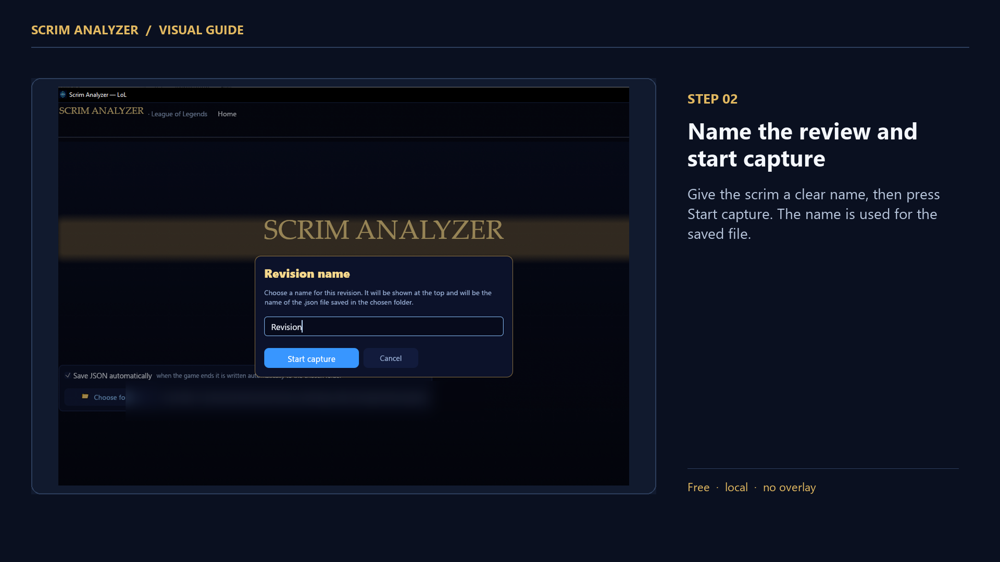
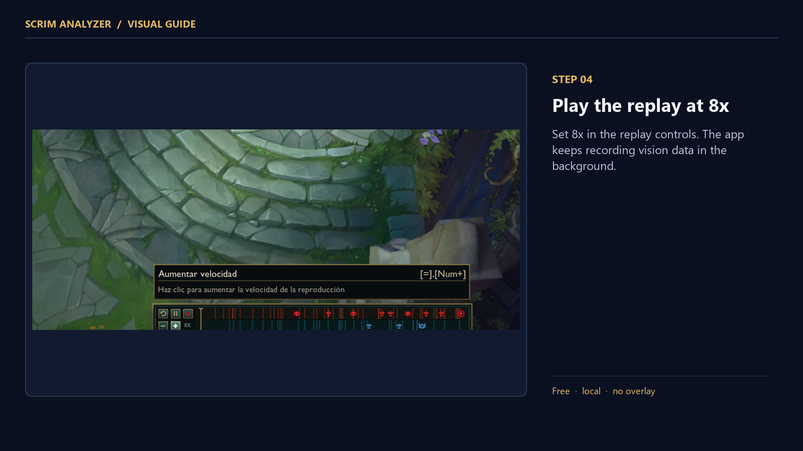
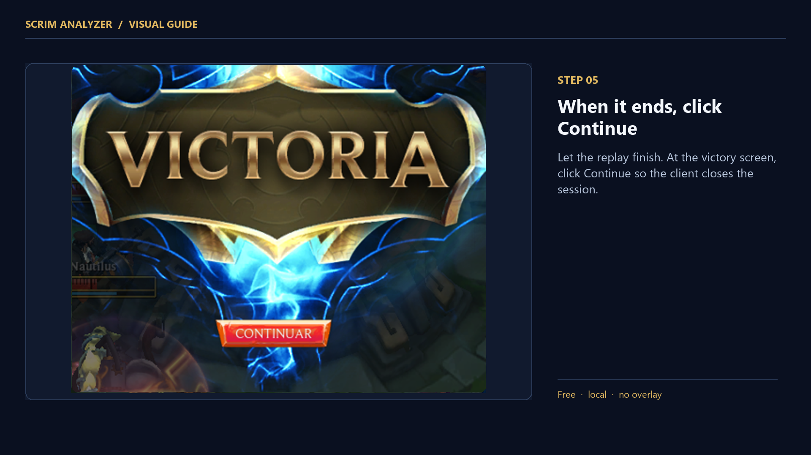
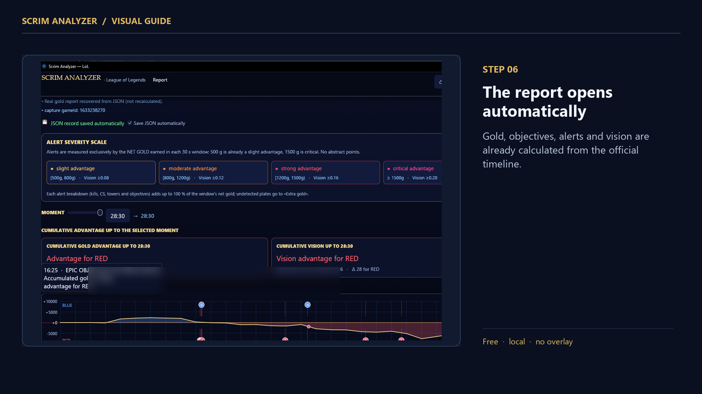
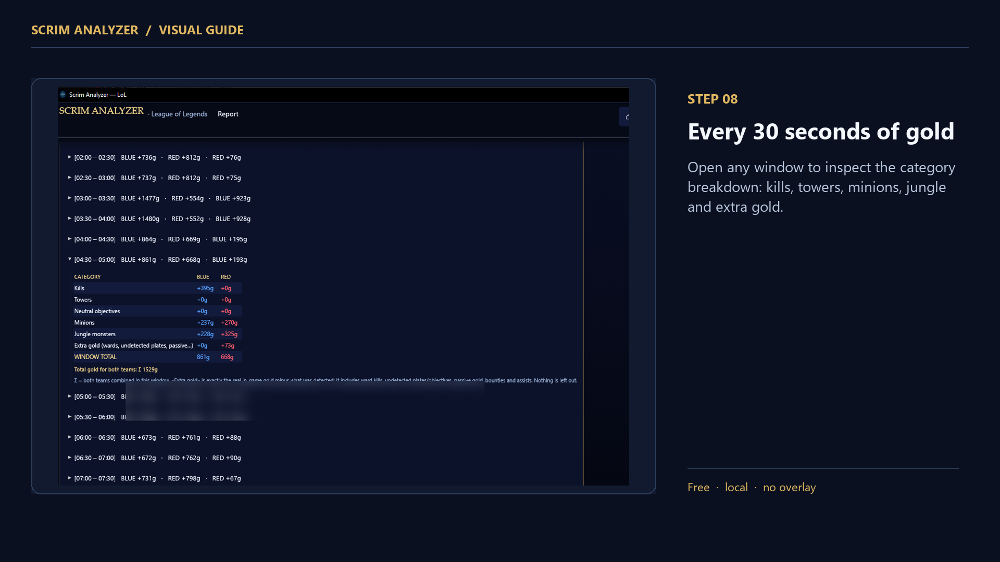
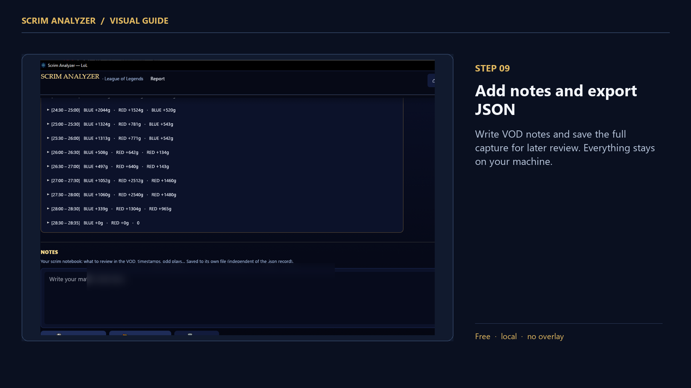

# Visual guide

Nine screenshots, in order, for the README or a step-by-step walkthrough.
All images live in [`screenshots/`](screenshots/) and are 1920×1080.

They are the **annotated** set: the step number, the title and the caption are
already drawn into the image, so each one works on its own in a gallery or a
carousel. Player names from the client are blurred or cropped out.

## 01 — Choose where captures are saved

Pick the folder where the app will store each JSON capture. Keep it somewhere
easy to find. The choice is remembered in `config.json`.

## 02 — Name the review and start capture

Give the scrim a clear name, then press **Start capture**. That name is shown at
the top of the report and is used for the saved `.json` file. If a file with the
same name already exists, the app saves `name (1).json`, `name (2).json`, etc.

## 03 — The app waits for the replay

Open League of Legends and load the `.rofl` file. The app detects the replay
automatically and keeps recording vision data in the background.

## 04 — Play the replay at 8x

Set **8x** in the replay controls. A 30-minute scrim takes about four minutes.
Do not close the replay early: the per-minute vision series is recorded while it
plays.

## 05 — When it ends, click Continue

Let the replay finish. At the victory screen, click **Continue** so the client
closes the session and the app can merge the live vision with the official
timeline.

## 06 — The report opens automatically

Gold, objectives, alerts and vision are already calculated from the official
timeline. The review name appears at the top.

## 07 — Gold alerts and vision dashboard

See the windows that decided the scrim, with the best vision windows for each
team. Alert bars are split in two: left half = severity, right half = the team
that held the advantage (blue / dark red).

## 08 — Every 30 seconds of gold

Open any window to inspect the category breakdown: kills, towers, minions,
jungle and extra gold.

## 09 — Add notes and export JSON

Write VOD notes and save the full capture for later review. Everything stays on
your machine.
